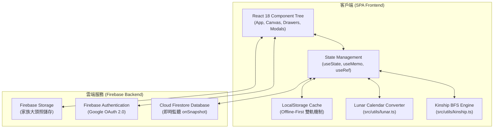

# 郭林家族數位族譜系統 (Interactive Family Tree Web App)

> 一個現代化、長輩友善、支援雲端即時同步與智慧親屬稱謂推導的數位家族族譜系統。

🌐 **線上正式站**：[https://imsmallnew.github.io/family-tree/](https://imsmallnew.github.io/family-tree/)

---

## 📖 目錄

1. [專案簡介與特色](#專案簡介與特色)
2. [核心功能亮點](#核心功能亮點)
3. [系統架構與技術方法](#系統架構與技術方法)
4. [親屬關係辨別邏輯與推導算法](#親屬關係辨別邏輯與推導算法)
5. [資料結構與多家族設計](#資料結構與多家族設計)
6. [本地開發與建置部署](#本地開發與建置部署)

---

## 🌟 專案簡介與特色

本專案專為跨世代家族傳承設計，解決傳統紙本族譜「查閱不易」、「稱謂複雜難懂」、「長輩視力不佳」與「資料無法即時維護」等痛點。系統採用 **React 18 + TypeScript + Vite 6 + Tailwind CSS + Firebase** 架構，兼具美觀、極致效能與長輩易讀性。

- **👵 長輩友善設計**：字級縮放（標準 / 大字 / 特大）、高對比配色、點選個人卡片完整展示資訊（含農曆生日、干支紀年、生肖、歲數與社群資訊）。
- **🧭 視角驅動族譜**：支援「訪客模式」全景查閱，或登入後自動以「本人視角」將畫面平滑置中，並以本人身分重新計算全家族親戚稱謂。
- **🧠 智慧親屬計算機**：內建圖論（Graph Theory）與廣度優先搜尋（BFS）稱謂推導引擎，自選兩人即可即時計算雙向互稱與完整血緣推導鏈。
- **🌐 獨立多家族支援**：支援在同一個前端網站下建立完全隔離的「外聯專屬家族族譜」，通行密碼、管理員白名單與成員名冊各自獨立。

---

## 🎯 核心功能亮點

### 1. 視覺化互動族譜畫布（Interactive Tree Canvas）
- **自由平移與縮放（Grab-to-Pan & Pinch-to-Zoom）**：支援滑鼠拖曳、手機雙指縮放，縮放比例由 30% 至 180% 自由調整。
- **世代色彩體系**：
  - 👑 **第一代**：金黃 / 天藍長老基底
  - 🌿 **第二代**：粉紅 / 玫瑰核心夫妻傳承
  - 🌱 **第三代**：翠綠青壯兄弟姐妹手足
  - 🟣 **第四代**：獨立紫色新世代專屬識別
- **分支切換**：頂部一鍵切換「總覽 / 🟦 父系 / 🟧 母系」，隱藏無關分支並平滑置中對應宗親。

### 2. 智慧親屬稱謂查詢與對照模式（Kinship Mode）
- **下拉快速選單**：支援「從 A 出發 ➔ 查詢 B」，免手動輸入中文姓名。選單依世代分組（`==== 第一代 ====`、`==== 第二代 ====`）並依姓氏筆劃聚類排序。
- **智慧關係卡片**：即時輸出雙向稱謂（「您稱呼他」與「他稱呼您」）以及詳細推導鏈（例：`媽媽 → 弟弟 (小舅) → 兒子`）。
- **完整親屬稱謂一覽表（63人矩陣）**：以世代分組呈現，清晰展示與目前視角成員之所有互稱關係，支援單擊直接在族譜定位置中。

### 3. 多重身份驗證與安全防護（Security Gate）
- **雙軌登入驗證**：
  - **長輩通行密碼**：首頁輸入 6 位數密碼（預設 `888888`）即可進入「唯讀防誤觸模式」，可勾選「記住密碼」下次自動登入。
  - **管理員 Google 驗證**：透過 Google 帳號登入，系統嚴格檢驗 Firebase 白名單（`authorizedEmails`），只有授權 Gmail 才具備新增、編輯與刪除權限。
- **Firestore 安全規則**：提供雲端安全規則腳本，於資料庫底層杜絕非授權寫入。

### 4. 跨家族互相串接與獨立族譜管理（Multi-Family Linking）
- **獨立家族一鍵新建**：管理員可於系統設定中新建外聯族譜，自訂家族代碼（例：`lin`）、專屬標題、通行密碼與管理員名單。
- **專屬分享網址**：自動產生獨立參數網址（例：`?family=lin`），資料自動隔離存於獨立 Firestore 集合。
- **伴侶人物卡片外聯按鈕**：點開伴侶人物卡片時，可一鍵另開分頁前往該伴侶家族的專屬族譜！

---

## 🛠️ 系統架構與技術方法



### 1. 前端現代化工程架構
* **React 18 + TypeScript**：嚴格型別定義，建構高內聚、元件化的單頁應用程式（SPA）。
* **Vite 6**：次世代前端建置工具，秒級熱更新（HMR）與生產環境最佳化打包（Production Build < 1.3 秒）。
* **Tailwind CSS**：原子化 Utility-First CSS，搭配自訂世代色彩與動畫關鍵影格。

### 2. 虛擬鏡頭與畫布平滑定位（Auto-Centering Camera）
族譜畫布透過動態幾何座標換算實現平滑運鏡：
```ts
// 透過節點座標與可視區域計算置中偏移量
const nodeEl = document.getElementById(`tree-node-${memberId}`);
if (nodeEl && treeViewportRef.current) {
  const container = treeViewportRef.current;
  const targetLeft = nodeEl.offsetLeft - container.clientWidth / 2 + nodeEl.clientWidth / 2;
  const targetTop = nodeEl.offsetTop - container.clientHeight / 2 + nodeEl.clientHeight / 2;
  container.scrollTo({ left: targetLeft, top: targetTop, behavior: 'smooth' });
}
```

### 3. 多租戶資料隔離與離線優先機制（Multi-Tenant & Offline-First）
* **Firestore 路徑動態分流**：
  * 主族譜（郭林家族）：存取頂層集合 `members`、`relationships`、`settings/familyInfo`。
  * 外聯獨立族譜（例：`family=lin`）：存取 `families/lin/members` 等子集合，互不干擾。
* **雙軌離線快取**：所有成員與設定均經由以家族代碼為命名空間的 `localStorage` 快取，無網際網路環境下依然能正常載入與查閱，恢復網路後自動雙向同步。

---

## 🧮 親屬關係辨別邏輯與推導算法

傳統中文親屬稱謂極其精確，牽涉**世代差**、**內親（堂）/ 外親（表）**、**性別**、**血親/姻親**以及**年齡長幼**。本系統將家族關係轉化為**圖論（Graph Theory）**，並運用**廣度優先搜尋（BFS）**與**稱謂規則引擎**自動解析。

### 1. 圖論建模（Graph Representation）
家族被建模為一個關係圖（Graph）：
- **節點（Nodes）**：成員個人資料（性別 `gender`、國曆生日 `birthday`、世代 `generation`、出生排行 `birthOrder`）。
- **邊（Edges）**：僅需登記 3 種最基礎的原子血緣關係，其餘所有複雜親屬皆由演算法自動推導：
  1. `parent`（A 是 B 的父母）
  2. `spouse`（A 與 B 是夫妻）
  3. `sibling`（A 與 B 是手足）

### 2. 廣度優先搜尋（BFS）最短路徑探索
從出發成員（視角 $A$）開始，以佇列（Queue）向外逐層搜尋目標成員 $B$。搜尋過程中，將經過的關係轉換為精確的代號序列（Token Chain）：

| 關係代號 (Token) | 含意 |
| :--- | :--- |
| `F` / `M` | 父親 (Father) / 母親 (Mother) |
| `S` / `D` | 兒子 (Son) / 女兒 (Daughter) |
| `OB` / `YB` | 哥哥 (Older Brother) / 弟弟 (Younger Brother) |
| `OS` / `YS` | 姊姊 (Older Sister) / 妹妹 (Younger Sister) |
| `H` / `W` | 丈夫 (Husband) / 妻子 (Wife) |

演算法最深探索至 6 層關係鏈。例如：
- 媽媽的弟弟的兒子：`M → YB → S`
- 爸爸的哥哥的妻子：`F → OB → W`
- 爸爸的姊姊的丈夫：`F → OS → H`

### 3. 親屬語法解析引擎（Grammar Resolution）
取得 Token 鏈後，進入稱謂解析引擎（[`src/utils/kinship.ts`](file:///Users/daniel_kuo/Documents/projects/family-tree/src/utils/kinship.ts)）：

#### (1) 直系與近親對照（1 ~ 2 步）
- `F,F` → 爺爺（阿公）｜ `M,F` → 外公
- `F,OB` → 伯父（阿伯）｜ `F,YB` → 叔叔（阿叔）
- `M,OB` / `M,YB` → 舅舅
- `F,OS,H` → 姑丈 ｜ `M,OS,H` → 姨丈

#### (2) 「堂」與「表」的嚴謹判定
- **堂親規則**：必須是**父親的兄弟之子女**（同姓氏、同宗血緣）：
  $$\text{鏈條結構：} F \to (OB \mid YB) \to (S \mid D) \implies \text{「堂」字輩}$$
- **表親規則**：只要路徑中經過「姑、舅、姨」（異姓血親）：
  $$\text{路徑包含 } M \text{（母系）或 } OS/YS \text{（姑姑）} \implies \text{「表」字輩}$$

#### (3) 年齡與排行長幼仲裁（Age & BirthOrder Arbitration）
- 比對兩人的國曆生日 `birthday`（若未填則比對排行 `birthOrder`）：
  - 對方較年長且為男性 $\implies$ 堂哥 / 表哥
  - 對方較年幼且為男性 $\implies$ 堂弟 / 表弟
  - 父母手足比父母年長 $\implies$ 伯父；比父母年幼 $\implies$ 叔叔

#### (4) 姻親與跨世代延伸（3 ~ 6 步）
- **堂表親之配偶**：
  - `堂哥 + 妻子` $\implies$ **堂嫂**
  - `表姊 + 丈夫` $\implies$ **表姊夫**
  - `堂弟 + 妻子` $\implies$ **堂弟媳**
- **世代交錯（第四代視角）**：
  - 父母的堂表兄弟姊妹：自動判定為 **堂伯 / 堂叔 / 堂姑 / 表舅 / 表姨**。
  - 第四代看其他同輩第四代：自動計算為 **再從堂兄弟姊妹**。

#### (5) 雙向互稱矩陣（Bidirectional Resolution）
系統同時計算：
1. **$A \to B$**：A 稱呼 B（例：`表哥`）
2. **$B \to A$**：B 稱呼 A（例：`表妹`）
3. 輸出直觀關係鏈（例：`媽媽 → 弟弟 (小舅) → 兒子`），兼顧宗族禮俗與人倫長幼。

---

## 💻 本地開發與建置部署

### 環境需求
- **Node.js**：>= 20.0.0
- **npm**：>= 9.0.0

### 1. 安裝依賴套件
```bash
npm install
```

### 2. 啟動本地開發伺服器
```bash
npm run dev
```
啟動後瀏覽器開啟 `http://localhost:5173` 即可進行本地除錯與開發。

### 3. 型別檢查與生產環境建置
```bash
npm run build
```

### 4. 部署至 GitHub Pages
本專案已設定自動化 `predeploy` 與 `gh-pages` 發布指令：
```bash
npm run deploy
```

---

## 📄 版權與維護

- **建置維護**：Daniel Kuo
- **版權宣告**：© 2026 All Rights Reserved.
- **專案授權**：Private Family Heritage Project.
